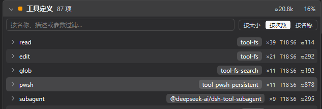
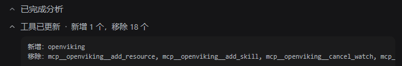
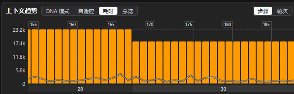

# dsh-tool-fold

For humans:

Do you keep loading plugins into DeepSeek Harness, registering one MCP server after another? If you also run [dsh-context](https://github.com/bowenliang123/dsh-context#readme) and watch the tool-definition cost of your sessions outside the minimal preset, it looks like this:



Dozens or hundreds of tools, each spending context on its own description and parameter schema — a single "hello" can burn 50k+ tokens before the reply starts.

This plugin lets you pick a batch to remove from the tool list — ideally the ones you rarely use — and leaves one thin query tool behind. Folded tools come back only when the model asks for them, or are proxied by an aggregate group. Folding is scoped to **agent presets**, so the same batch can disappear in one preset's sessions and stay visible in another.





With the OpenViking MCP server as an example: I keep only the `read` tool visible and fold the rest into one aggregate group.

That is the whole idea. [CONTEXT](CONTEXT.md) has the vocabulary, and the sections below have the mechanics. Contributions welcome.

---

## Two kinds of group

| Kind | What the model sees | How it uses those tools |
| --- | --- | --- |
| **Fold group** | One query tool whose `op` is `list`/`find`, `expand`, or `retract` | After `expand` the tools return to the tool list and are called directly next turn; `retract` hides them again |
| **Aggregate group** | One query tool whose `op` is `find` or `call` | It never expands; `call` is executed by the Host through the full approval and guard pipeline |

A fold group is temporary relief: expanding affects the current session only, and a restart returns to fully folded. An aggregate group is a permanent facade: the original tools stay invisible and the model can only reach them through `call`, which suits tools you want invoked on explicit instruction rather than kept in the tool list.

## Install

Requires DeepSeek Harness `0.2.1-rc.2` or newer (Cordis 4.x). The settings page is Web-only.

```sh
dsh plugin --profile web add github:Sodapopper-pixel/dsh-tool-fold
```

Restart the Host once after installing — this is a Host-side plugin and it loads at startup — then open **Settings → Tool fold**.

## Configure


On the settings page: add a fold or aggregate group → name the query tool → pick its query form (list tool names, or a summary with search) → check the agent presets it applies to → check the tools to fold → save.

- The configuration lives in `~/.dsh/tool-fold/config.json` (honouring `DSH_HOME`). The page writes it and the Host validates before saving; writes go through a temporary file and a rename, so a crash cannot leave half a file.
- A tool belongs to at most one group, and the two kinds are mutually exclusive. Tools bound elsewhere are disabled in the picker.
- A query tool name that collides with a registered tool is rejected and marked red: a same-scope registration would shadow the original tool, and silent shadowing is the worst outcome.
- Saved changes apply to new sessions; a session already open picks them up only when a new one starts.

## Behaviour

- **Per preset.** A group applies only to the presets it claims, by the preset id the Host reports for a session. A group that claims no preset does nothing.
- **Fold and reveal.** Folding uses the Host's scope-level tool restriction (`ctx.tools.restrict`): a folded tool is invisible and uncallable for the model. Revealing removes the restriction, and the tool is back in the next turn's tool list. The plugin's own query tool is unaffected.
- **Late and missing registrations.** A bound tool that does not exist yet when the session is created (MCP server not connected, plugin registering later) is skipped and flagged on the page; when the Host's tool table changes, newly appeared bound tools are folded in then.
- **Proxy execution.** An aggregate group's `call` forwards through the Host's tool execution entry point with `parent` set to the current call token, so argument validation, approval, guards, and result rendering behave exactly as a direct model call. The forwarded tool stays folded in the session: the plugin reveals it for that one call and folds it again as soon as the call returns, without touching the Host's global tool table.
- **Unloading restores everything.** Restrictions belong to each session's own scope, so unloading or hot-reloading the plugin reveals every folded tool and unregisters the query tools instead of leaving tools that are neither visible nor callable.

## Known limits

- **Idle auto-retract has no turn signal yet.** The "retract after idle turns" checkbox and threshold exist, but the plugin has no subscribable turn boundary, so the setting does not change behaviour yet.
- **The tool catalog depends on the assembly hook.** Third-party plugins cannot obtain the Host's scope key, and `schemas()` only reports the global layer; preset-scoped tools enter the catalog after a session has assembled once. Tools the catalog does not have yet can be bound by typing their name.
- **The fold list is read from a Host error message.** A third-party plugin has no other way to enumerate, so it deliberately restricts an unknown name and parses the `known global tools:` list out of the rejection. If the Host words that rejection differently, folding goes quiet: the plugin logs a warning, the settings page shows nothing.
- **Provenance is inferred.** The Host does not record which part of the deployment registered a tool. Builtins are recognized by name table, plugin tools by scanning installed packages' entry modules; a minified or dynamically named package is not recognized and shows as "builtin or plugin tool".
- Folding changes tool visibility only; it does not shrink the session log.

## Development

```sh
node scripts/build.mjs                    # emits lib/ (Host modules copied, one browser bundle)
node --test "tests/*.test.mjs"            # unit tests
node scripts/sync-installed.mjs --check   # local dev: is the installed copy stale?
node scripts/sync-installed.mjs --apply   # local dev: mirror this checkout into the web profile
```

`tests/` also holds Playwright scripts that check the real page: the save path, provenance labels, the unsaved-changes indicator, and the tool detail panel.

## Documentation

- [CONTEXT.md](CONTEXT.md): glossary
- [docs/design.md](docs/design.md): Host mechanics, implementation path, and how it was verified
- [docs/adr/](docs/adr/): architecture decisions

## License

MIT, see [LICENSE](LICENSE).
