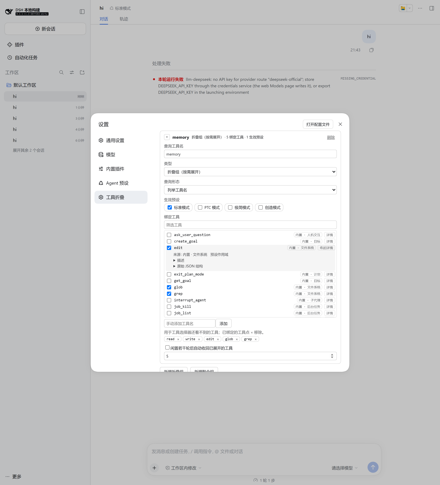

# dsh-tool-fold

把一批已注册工具折叠成一个查询工具：模型需要时才展开直调，或干脆交给聚合组代执行。折叠按**代理预设**生效——同一批工具可以只在某个预设的会话里消失。

装得多了，模型的工具列表会一路涨到几十上百条，每条都带着自己的描述和参数 schema 占着上下文。这个插件让你挑一批（含 MCP 来的工具）从工具列表里摘掉，留一个薄薄的查询工具给模型按需使用。



## 两种组

| 类型 | 模型看到什么 | 模型怎么用那些工具 |
| --- | --- | --- |
| **折叠组** | 一个查询工具，`op` 可取 `list`/`find`、`expand`、`retract` | `expand` 后工具回到工具列表，下一轮直接调用；`retract` 收回 |
| **聚合组** | 一个查询工具，`op` 可取 `find`、`call` | 从不展开；`call` 由宿主代执行，走完整的审批与 guard 管道 |

折叠组是"临时放出来"：展开只影响当前会话，重启后回到全折叠。聚合组是"永久代理"：原工具永远不可见，模型只能通过 `call` 间接使用，适合那些只想让它在明确指令下被调用、不希望它常驻工具列表的工具。

## 安装

需要 DeepSeek Harness `0.2.1-rc.2` 或更高（Cordis 4.x），并且只在 Web 界面提供设置页。

```sh
dsh plugin --profile web add github:Sodapopper-pixel/dsh-tool-fold
```

装完重启一次 Host（这是 Host 侧插件，装载发生在启动时），然后打开 **设置 → 工具折叠**。

## 配置

在设置页里：新增折叠组或聚合组 → 填查询工具名 → 选查询形态（列举工具名 / 概括加搜索）→ 勾生效的代理预设 → 勾要折叠的工具 → 保存。

- 配置存在 `~/.dsh/tool-fold/config.json`（遵循 `DSH_HOME`），由页面写入，Host 校验通过才落盘；写入是临时文件加重命名，不会留下半个文件。
- 一个工具最多绑一个组，折叠组与聚合组之间也互斥；已经绑到别处的工具在选择列表里置灰。
- 查询工具名与任何已注册工具重名时保存会被拒并标红——宿主同一作用域里的同名注册会遮蔽原工具，静默覆盖是最坏的结果。
- 改动保存后对新会话生效；已开着的会话要另开一个才会带上折叠。

## 行为细节

- **按预设生效**：一个组只对勾选的预设生效，判定依据是宿主报给会话的预设 id；没勾预设的组不生效。
- **折叠与展开**：折叠走宿主的作用域级工具限制（`ctx.tools.restrict`），模型看不到被折叠的工具，也无法调用；展开即撤销限制，下一轮工具列表里就回来了。插件自己的查询工具不受限制影响。
- **晚注册与缺失**：绑定的工具在会话创建时还不存在（MCP 没连上、插件后注册），先跳过并在页面上标出来；宿主工具表变化后，新出现的绑定工具会被补上折叠。
- **代执行**：聚合组的 `call` 通过宿主的工具执行入口转发，`parent` 带上当前调用令牌，所以参数校验、审批、guard、结果渲染都与模型直接调用时一致。被代理的工具在会话里始终是折叠状态，插件只在这一次转发期间临时放开它、转发结束立刻收回，宿主的全局工具表本身不变。
- **卸载即还原**：工具限制挂在会话自己的作用域上，所以插件被卸载或热重载时会把折叠全部撤销、连同查询工具一起注销，不会留下一个"看不见也调不动"的工具。

## 已知边界

- **闲置自动收回还没接上轮次信号**：页面上的"闲置若干轮后自动收回"可勾选、阈值可调，但插件还没拿到可订阅的轮次边界，这项设置目前不改变行为。
- **工具目录依赖装配回调**：第三方插件拿不到宿主的作用域键，`schemas()` 只能看到全局层的工具；预设作用域里的工具要等会话装配过一次才进目录。目录里还没有的工具可以手动输入名字绑定。
- **折叠名单读自宿主的一句校错文案**：第三方插件没有别的枚举途径，只能故意提交一个不存在的限制名，从宿主报错的 `known global tools:` 列表里读出可折叠的名字。宿主换掉这句文案时折叠会失效，插件会写一条 warn 日志，但页面上看不出来。
- **来源徽标是推断的**：宿主登记工具时不记录提供方。内置工具靠名字表认，插件工具靠扫描已安装包的入口代码；压缩或动态拼名的包扫不到，会显示为「内置或插件工具」。
- 折叠只影响工具可见性，不减少会话日志。

## 开发

```sh
node scripts/build.mjs                    # 生成 lib/（Host 模块逐个复制 + 单文件浏览器 bundle）
node --test "tests/*.test.mjs"            # 单元测试
node scripts/sync-installed.mjs --check   # 本地开发：安装副本是否过期
node scripts/sync-installed.mjs --apply   # 本地开发：把本源目录镜像进 web profile
```

`tests/` 下另有几个 Playwright 脚本，用来在真机页面上核对保存路径、来源标签、未保存提示与工具详情。

## 文档

- [CONTEXT.md](CONTEXT.md)：术语表
- [docs/design.md](docs/design.md)：宿主机制、实现路径与验收方式
- [docs/adr/](docs/adr/)：架构决策记录

## 许可

MIT，见 [LICENSE](LICENSE)。
